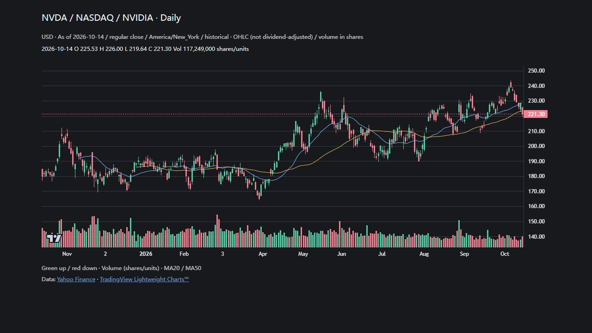
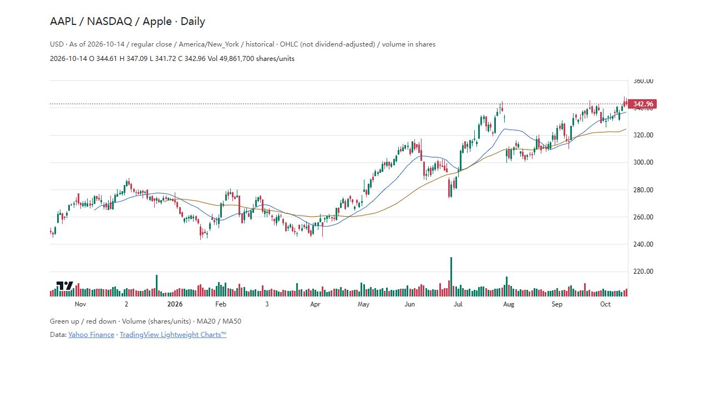
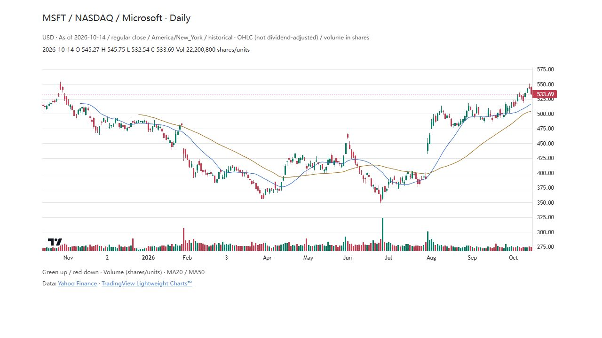

# tradingview-chart

**Give your agent an interactive market chart.**

English · [简体中文](README.zh-CN.md)

[](https://github.com/RaoHai/tradingview-chart-skill/actions/workflows/test.yml)
[](LICENSE)
[](scripts/build_chart.py)
[](https://github.com/tradingview/lightweight-charts)

A small `SKILL.md` package for Codex and compatible agents. Turn sourced OHLCV into candlesticks, volume and moving averages with **TradingView Lightweight Charts™**. Zoom, pan and inspect prices with a crosshair, inside a compatible conversation host or in a standalone browser page.



*Actual builder output · NVDA / NASDAQ · 251 daily bars, 2025-10-15–2026-10-14 · frozen historical data, not live quotes. [Data and screenshot provenance](docs/SHOWCASE.md).*

## Why this skill

When discussing markets with an AI agent, I want an interactive chart right beside the conversation: zoom into candles, drag through history and inspect prices with a crosshair. I packaged that capability as a reusable skill, with a repeatable workflow: **verify the instrument and data → build → check the render → explain the chart**.

- **Interactive by default.** Candles, volume, MA20/MA50, optional support/resistance lines, native zoom/pan and crosshair.
- **Traceable observations.** Source, date, currency and adjustment convention travel with the input. The builder checks dates, numeric values and OHLC bounds.
- **Portable output.** An inline HTML fragment for compatible hosts, or `--standalone` for a browser page with light/dark theming.
- **Small runtime.** Python 3.10+, standard library only. A pinned chart library loads from a CDN.

The agent obtains and verifies the market data using its available tools. This package renders supplied JSON; it does not include a quote subscription, data downloader or order execution. Structural validation does not prove a quote is correct.

## Install the skill

```bash
git clone https://github.com/RaoHai/tradingview-chart-skill.git ~/.codex/skills/tradingview-chart
```

Windows PowerShell:

```powershell
git clone https://github.com/RaoHai/tradingview-chart-skill.git "$env:USERPROFILE/.codex/skills/tradingview-chart"
```

If `CODEX_HOME` is set, use its `skills/tradingview-chart` directory instead. Compare existing local changes before replacing an installed skill. Start a new agent session to discover the skill.

Then ask:

> Use $tradingview-chart to chart NVDA over the last year. Include volume and MA20/MA50, verify the source and adjustment convention, and state the last trading session.

Other `SKILL.md`-compatible agents can load the same folder through their own skill installation mechanism. Inline display depends on the host; standalone HTML does not need Codex.

## Try it without an agent

From the repository root:

```bash
python scripts/build_chart.py --input docs/examples/NVDA.json --output output/chart.html --standalone
python -m http.server 8765 --directory output
```

Open **http://localhost:8765/chart.html**, or open the HTML file directly. No pip packages or API key are required for this bundled historical example. Internet access is needed for the chart library from jsDelivr.

Remove `--standalone` to generate an inline fragment. The embedding host must supply theme variables and allow its scripts and the pinned CDN library.

## Check data before rendering

Validate without generating HTML, and optionally save a JSON report:

```bash
python scripts/build_chart.py --input docs/examples/NVDA.json --check --report output/quality.json
```

You can also add `--report output/quality.json` to a normal build. Reports include first/last supplied sessions, bar and volume counts, available MA windows, and errors/warnings with a `code` and field `path`. Invalid input exits with code `2`; warnings alone exit with `0`. An invalid build does not write or update the chart, so an existing output may belong to an earlier successful build. Input, chart and report must use different paths.

Missing volume, missing retrieval time and insufficient MA20/MA50 history produce warnings without filling data. Charts display the supplied range, volume coverage, insufficient MA history and retrieval time when recorded. Optional `retrieved_utc` must be an ISO 8601 UTC datetime ending in `Z` or `+00:00`, such as `2026-10-27T01:00:00Z`. Existing inputs without it still render.

Checks are structural only: they do not verify quotes, trading-calendar completeness or adjustment consistency. A source link is not independent verification. Weekends and holidays are not flagged as missing sessions.

## More examples

| Apple · light | Microsoft · light |
| --- | --- |
|  |  |
| [AAPL input](docs/examples/AAPL.json) | [MSFT input](docs/examples/MSFT.json) |

All screenshots show real, frozen historical OHLCV from the same feed for price and volume. The examples use English chart labels (`locale: "en-US"`); Chinese labels remain available as the default. See [snapshot metadata and reproduction](docs/SHOWCASE.md).

## Bring your own data

Use UTF-8 JSON with these fields:

| Field | Meaning |
| --- | --- |
| `symbol` | Ticker, ideally exchange and instrument name |
| `currency` | Price currency |
| `as_of` | Last session, market timezone, regular/after-hours and delay note |
| `source_name`, `source_url` | Data provider and HTTPS source URL |
| `adjustment` | Raw / adjusted convention and volume unit conversion |
| `bars` | Nonempty array of `time`, `open`, `high`, `low`, `close`, optional `volume` |

Dates must use `YYYY-MM-DD`; duplicates are rejected and bars are sorted. Prices must be positive, finite and satisfy OHLC bounds. Volume is nonnegative and expressed in shares/ETF units, not lots or turnover. Omit missing volume; never fill it with zero. Do not insert market holidays.

Optional `locale` selects `en-US` or `zh-CN` (default). Optional `levels` entries have a positive `price`, text `title`, and `kind` of `support` or `resistance`. These are analyst annotations, not fair-value estimates. Additional provenance such as `retrieved_utc` can be retained in the JSON.

MA20/MA50 use supplied closes and appear only when enough observations exist. The builder does not repair missing sessions or inconsistent adjustments. Text is escaped before JSON is embedded in HTML. See [the complete NVDA example](docs/examples/NVDA.json) for a complete input.

## Development

```bash
python -m unittest discover -s tests -v
```

Tests cover OHLC and finite-number constraints, date conflicts, omitted volume, sorting, safe embedding and standalone export. CI runs on Python 3.10 and 3.13.

## License and attribution

Original skill instructions, scripts and templates: [MIT](LICENSE). TradingView Lightweight Charts 5.0.0: Apache-2.0; see [third-party notices](THIRD_PARTY_NOTICES.md). The templates preserve TradingView attribution and its link. This is an independent community project, not an official TradingView product.

Historical market-data examples retain their own source metadata and are not covered by the software's MIT license. No personal holdings, account logs or private trading research are included.
