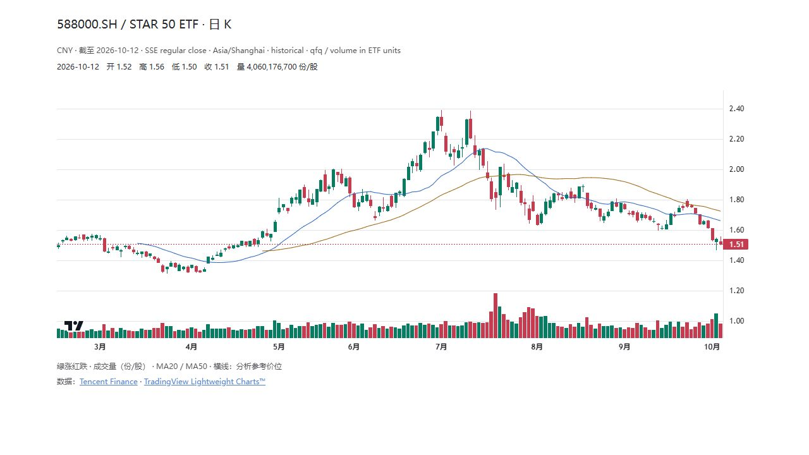
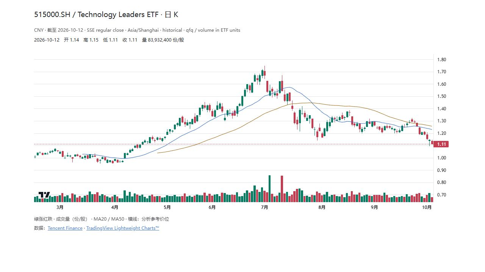
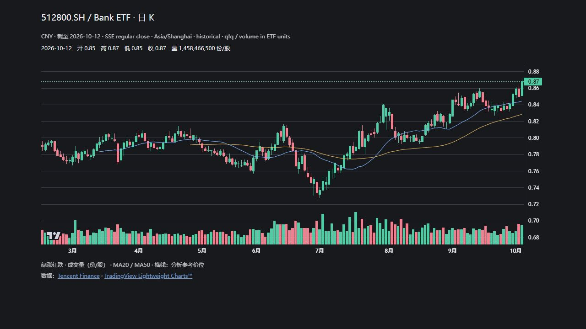

# tradingview-chart

**给智能体加一张可交互的行情图。**

[English](README.md) · 简体中文

[](https://github.com/RaoHai/tradingview-chart-skill/actions/workflows/test.yml)
[](LICENSE)
[](scripts/build_chart.py)
[](https://github.com/tradingview/lightweight-charts)

一个适用于 Codex 等兼容 `SKILL.md` 智能体的轻量技能。使用 **TradingView Lightweight Charts™**，把有来源的 OHLCV 画成日 K、成交量和均线；支持缩放、拖动和十字光标，可在兼容的对话宿主内展示，也能导出独立网页。



*生成器实际输出 · 588000.SH · 2026-02-06—2026-10-12，共160个交易日 · 历史快照，非实时行情。[数据与截图来源](docs/SHOWCASE.md)。*

## 为什么做这个

和 AI 讨论行情时，我希望它能直接画一张可以缩放、拖动、查看价格的 K 线图，于是把这个能力封成了可复用的技能。它把流程固定下来：**核验标的和行情 → 生成图表 → 检查渲染 → 结合图形解释**。

- **图表可以操作。** 日 K、成交量、MA20/MA50、可选支撑／压力线，以及原生缩放、拖动、十字光标。
- **数据可以追溯。** 输入保留来源、日期、币种、复权口径；生成器检查日期、数值和 OHLC 上下界。
- **输出可以带走。** 对话 HTML 片段或 `--standalone` 独立网页，支持亮暗主题。
- **运行依赖很少。** Python 3.10+，只用标准库；浏览器从 CDN 加载固定版本图表库。

行情由智能体通过宿主可用工具获取并核验。本包只渲染输入 JSON，不自带行情订阅、下载器或交易执行功能。格式校验通过不等于行情本身正确。

## 安装技能

```bash
git clone https://github.com/RaoHai/tradingview-chart-skill.git ~/.codex/skills/tradingview-chart
```

Windows PowerShell：

```powershell
git clone https://github.com/RaoHai/tradingview-chart-skill.git "$env:USERPROFILE/.codex/skills/tradingview-chart"
```

若设置了 `CODEX_HOME`，使用其 `skills/tradingview-chart` 目录。已有同名技能时先比较本地修改，避免覆盖。启动新会话加载技能后，可以说：

> 使用 $tradingview-chart 核验 588000 的近一年日线，画出成交量、MA20/MA50，并说明来源、复权口径和最后交易日。

其他兼容 `SKILL.md` 的智能体按其安装机制加载同一文件夹。对话内联展示依赖宿主支持；独立 HTML 不依赖 Codex。

## 不使用智能体也能试

在仓库根目录运行：

```bash
python scripts/build_chart.py --input docs/examples/588000.json --output output/chart.html --standalone
python -m http.server 8765 --directory output
```

浏览器打开 **http://localhost:8765/chart.html**，也可直接打开生成的 HTML。运行包内历史示例无需 pip 依赖或 API key；加载 jsDelivr 上的图表库需要联网。

去掉 `--standalone` 即输出 HTML 片段。嵌入宿主需提供主题变量，并允许执行片段脚本和固定版本 CDN 图表库。

## 更多标的

| 科技龙头 · 亮色 | 银行 · 暗色 |
| --- | --- |
|  |  |
| [515000.SH 输入](docs/examples/515000.json) | [512800.SH 输入](docs/examples/512800.json) |

三个示例均为真实历史行情，价格与成交量使用同一来源。图表标签目前使用中文，英文介绍见 [English README](README.md)。[快照口径与复现方法](docs/SHOWCASE.md)记录了数据日期、来源及截图方式。

## 换成自己的数据

提供 UTF-8 JSON：

| 字段 | 含义 |
| --- | --- |
| `symbol` | 代码，建议附交易所和名称 |
| `currency` | 价格币种 |
| `as_of` | 最后交易日、市场时区、常规盘／盘后与延迟说明 |
| `source_name`, `source_url` | 数据来源名称与 HTTPS 地址 |
| `adjustment` | 不复权／前复权等口径及量能单位转换 |
| `bars` | 非空日线数组：`time`, `open`, `high`, `low`, `close`，可选 `volume` |

`time` 必须是 `YYYY-MM-DD`；日期不得重复，生成器会排序。价格须为正的有限数且满足 OHLC 上下界；量须为非负有限数，单位为股／份，不是手或成交额。缺量直接省略，不能填零；休市日不插值。

可选 `levels` 数组，每项包含正数 `price`、文字 `title` 和 `kind`（`support` / `resistance`）。这些是研究参考线，不是公允价值。可添加 `retrieved_utc` 等追溯字段。

MA 按输入日线收盘价计算，窗口不足时不绘制。生成器不修复缺失交易日或复权不一致，调用方须先核验数据；嵌入文本会转义处理。完整输入也可参考[较小的原始示例](examples/588000-historical.json)。

## 开发与验证

```bash
python -m unittest discover -s tests -v
```

覆盖 OHLC 约束、非有限数、日期冲突、缺量保留、排序、嵌入转义和独立网页输出。GitHub Actions 在 Python 3.10 / 3.13 运行。

## 许可与来源

原创技能、脚本和模板使用 [MIT License](LICENSE)。TradingView Lightweight Charts 5.0.0 使用 Apache-2.0，详情见[第三方说明](THIRD_PARTY_NOTICES.md)。模板保留 TradingView 标识与链接。本项目与 TradingView 无隶属关系。

历史行情示例保留来源元数据，不纳入 MIT 软件授权。公开包不含个人持仓、账户日志或私人交易研究。
